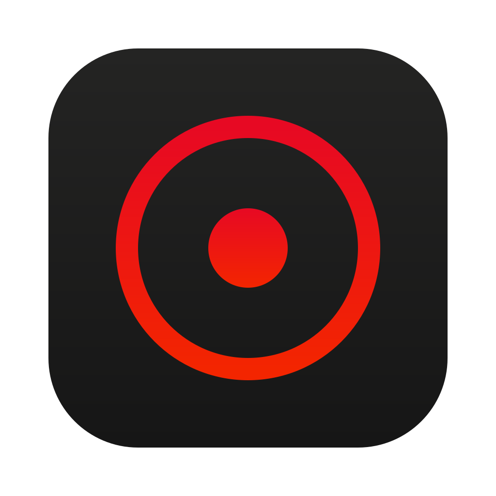

# Design

How Xiao looks and why. Five principles, each turned into rules a change can be checked against.

## Principles

### Care

People use Xiao when privacy matters to them, so nothing about it should be careless.

- Every text and background pair meets WCAG AA (4.5:1). The table below lists the measured ratios.
- `prefers-reduced-motion` turns animation off (`--quick` and `--calm` drop to 0 ms).
- Copy says what Xiao does and what it doesn't. The limits (Tor tabs aren't anonymity, Windows is tested only by CI) stay as easy to find as the features.

### Simplify

- One accent colour, `#e70923`, the same in light and dark. Two typefaces: Junicode italic for headings, Bricolage Grotesque for everything else (the pair zen-browser.app uses).
- One mark, shown once on any screen: the toolbar button in the browser, the header on the website, above the name on Xiao Search. The start page and its tab carry the word "Xiao" only.
- Every element has a job. If it doesn't tell the user something or let them do something, it goes.
- Defaults that work without settings. Strict mode is one flag, not a page of switches.

### Unite

The start page, the toolbar panel, Zen's own UI, Xiao Search, the website, the kit and the fork share one look because they share the same sources:

| Source | Produces |
| --- | --- |
| `shared/tokens.css`, `shared/fonts/` | Every colour, font and timing on the start page and the website; `core/chrome.css` and `kit/search/xiao.css` use the same values |
| `fork/branding/source/*.svg` | All app icons via `fork/branding/make.sh`: the fork's PNG, ICO and ICNS set, the kit's `xiao.icns`, `xiao.ico` and `xiao.svg`, and the website's favicons. `wordmark.svg` is drawn by `fork/branding/wordmark.py`. |
| `core/icons/xiao.svg` | The bare mark: toolbar button, Xiao Search, README; copied to `site/public/favicon.svg` |
| `shared/prefs/look.yaml` | Zen's own accent colour, in the kit and the fork |
| `npm run e2e` | The start page, Tor tab and Xiao Search screenshots in `test/e2e/out/`, copied to `site/src/assets/` |

Change the source, then regenerate. Never edit a generated file by hand.

### Trust

- Red is the accent, never the surface. Pages stay warm neutral paper and ink, because a red page reads as an error.
- Tor is always violet (`--tor`), so a Tor tab can never be mistaken for anything else.
- State is never shown by colour alone. Tor being on is written out ("Tor is connected"), not just tinted.
- Zen is credited by name wherever Xiao depends on it. Xiao doesn't pretend to be more than it is.

### Elevate

Xiao should be the easiest private browser to recommend:

- **Compared with Zen:** the same calm browser, with ad and tracker blocking built into the browser, 79 hardened settings and Tor tabs from the first start.
- **Compared with Brave:** Firefox's engine, no rewards, wallet or sponsored content, and every setting it changes is listed on [one page](https://gitguy268.github.io/xiao/privacy/).
- **Compared with Tor Browser:** everyday speed for most tabs, with Tor one click away for the sites that need it. When anonymity matters, Xiao says to use Tor Browser.

## Palette

Taken from [iColorPalette p/601840](https://icolorpalette.com/p/601840):

| | | | | |
| --- | --- | --- | --- | --- |
| `#9e0618` | `#e70923` | `#ff0505` | `#f32500` | `#eb492d` |

| Token | Light | Dark | Use |
| --- | --- | --- | --- |
| `--accent` | `#e70923` | `#e70923` | The mark, primary buttons, focus rings, the toolbar badge, Zen's accent. Fills, borders and rings only, never text. |
| `--accent-text` | `#c4071d` | `#f36a52` | Red words: the italic words in the website's headings |
| `--accent-ink` | `#ffffff` | `#ffffff` | Text on `--accent` |
| `--pool-a` / `--pool-b` | `#f3c7c8` / `#f5cdc1` | `#44020a` / `#410e06` | The soft glow at the foot of the start page |
| `--tor` | `#7b4fd6` | `#b49af0` | Everything to do with Tor |
| `--paper` / `--ink` | `#eeeee7` / `#1d1d1b` | `#1b1b1b` / `#ececE4` | Page and text |
| Mark gradient | `#e70923` → `#f32500` | | Crimson to orange-red, top to bottom |
| Private-window icon | `#fa8d9a` on `#44020a` | | |

Measured contrast:

| Pair | Ratio | Needs |
| --- | --- | --- |
| White on `--accent` (buttons, badge) | 4.7:1 | 4.5:1, text |
| White on hovered button (`--accent` 88% with black) | 5.8:1 | 4.5:1, text |
| `--accent` against light / dark paper | 4.0:1 / 3.7:1 | 3:1, UI parts and focus rings |
| `--tor` on light / dark paper | 4.6:1 / 7.2:1 | 4.5:1, text |
| `--accent-text` on light / dark paper | 5.3:1 / 5.7:1 | 4.5:1, text |

`--accent` is too light for body text on light paper (4.0:1) and too dark on dark paper (3.7:1), so text is always `--ink`, `--ink-soft`, `--tor` or `--accent-text`.

## Type

- **Bricolage Grotesque** for UI, body text and the big website headings (weight 650, tight tracking). It's also the font of Zen's own UI in Xiao (`core/chrome.css`).
- **Junicode italic** for the greeting, the start page's links and the one or two words of a heading set in red. It gives the calm, editorial voice. `shared/fonts/junicode-italic-latin.woff2` is the variable font fixed at weight 400 and subset to Latin (23 KB).
- Both are SIL OFL 1.1 and ship with Xiao, so nothing loads from a font CDN.

## The mark

A still dot inside a ring. On its own it's drawn in the red gradient. As an app icon it sits on a near-black rounded square on Apple's 824 px grid inside 1024. The wordmark is "Xiao" in Junicode italic, drawn as outlines so the About dialog shows it without the font. The name is written "Xiao" wherever people read it; `xiao` stays only in identifiers (folders, the bundle id, the window class).
