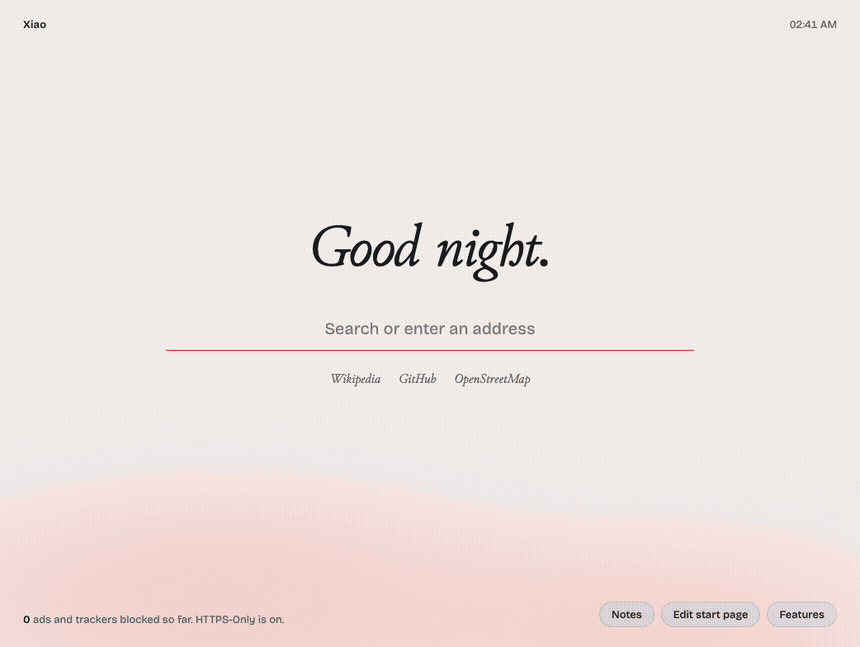
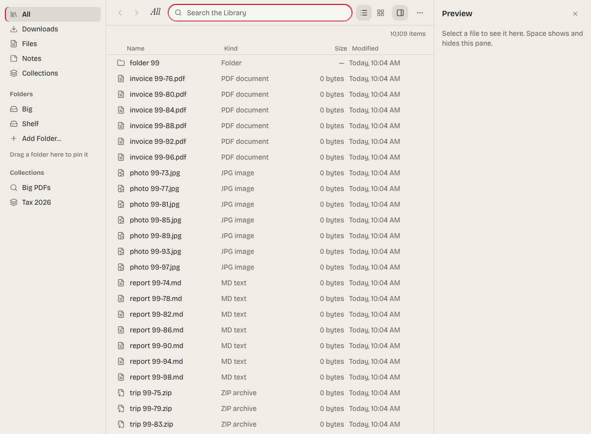
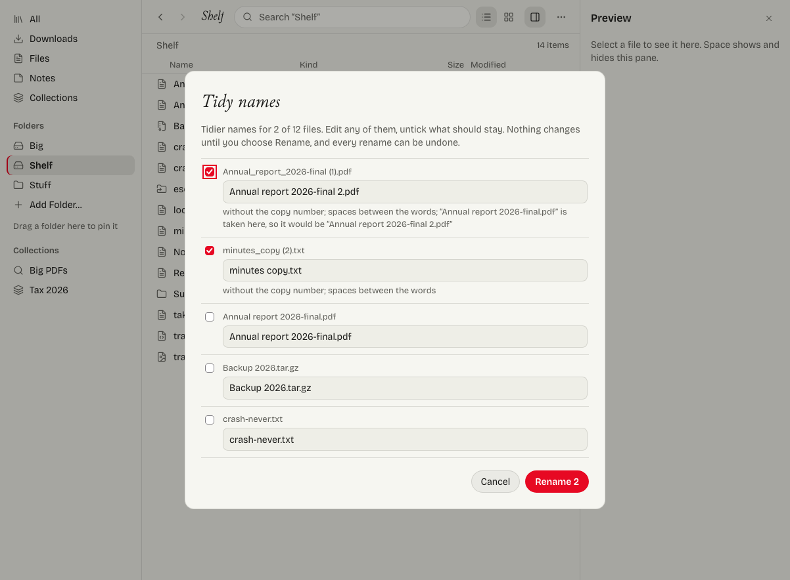
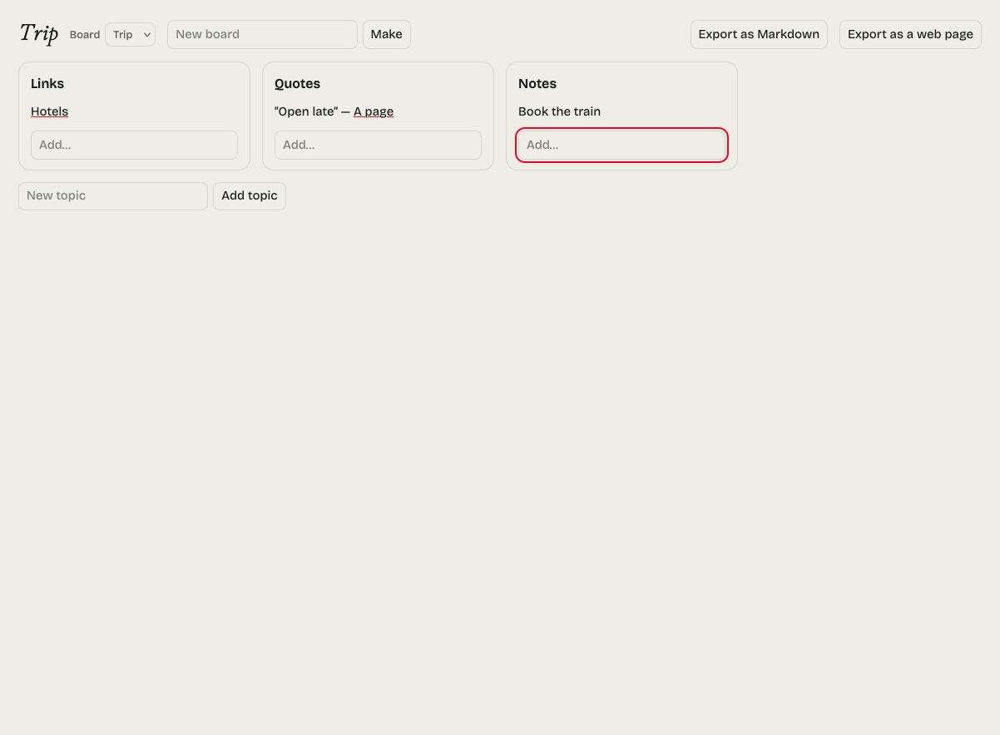

<div align="center">


# Xiao

A calm, private browser built on Zen: ad and tracker blocking built into the browser, stricter privacy settings, Tor tabs, and a search of your own.

[Website](https://gitguy268.github.io/xiao/) · [Download](https://gitguy268.github.io/xiao/download/) · [What it changes](https://gitguy268.github.io/xiao/privacy/) · [Release notes](https://gitguy268.github.io/xiao/release-notes/) · [Build from source](fork/README.md)

[](https://github.com/Gitguy268/xiao/actions/workflows/ci.yml)


</div>

## What it does

| | |
| --- | --- |
| Blocks ads and trackers | Built into the browser, not an extension. Ghostery's open-source engine with EasyList, EasyPrivacy and uBlock Origin's lists, prebuilt and refreshed daily, including hiding empty ad slots. Switch it off per site from the Xiao button. |
| Uses less memory | With six busy sites open, the add-on process holds 39 MB instead of 0.1's 290 MB, even after Firefox frees what it can. The whole browser uses 2,179 MB instead of 3,193 MB after a minute, and 1,821 MB instead of 2,026 MB after freeing memory. These are medians of three runs; [how it was measured](https://gitguy268.github.io/xiao/privacy/#memory). |
| Hardens 79 settings | No telemetry or studies, strict tracking protection, HTTPS only, DNS over HTTPS, no early connections, WebRTC without local addresses. Six more settings keep idle processes and tabs from holding memory. Strict mode adds 10, including Tor Browser's fingerprinting resistance. [Full list](https://gitguy268.github.io/xiao/privacy/). |
| Tor tabs | A "Tor" container whose tabs go through Tor, with a circuit per site (and a new one from the Xiao button) and WebRTC removed. If Tor stops, they fail; they never fall back to a direct connection. |
| Searches with SearXNG | searx.ononoki.org by default, then priv.au, then Brave Search: a search one of them refuses or can't answer is sent on to the next with the same words. Or pick DuckDuckGo, Mullvad Leta, Startpage, Brave or your own. |
| Xiao Search | Optional: your own [SearXNG](https://github.com/searxng/searxng), in Xiao's style, on this computer only and running only while Xiao does. |
| A Library of your files | One searchable place for your downloads, the folders you give it, your notes, collections and closed tabs, in Xiao's own look, built from [OpenFinder](https://github.com/Gitguy268/openfinder). Downloads keep the name they came with, so a renamed file is still found; tidy names are proposed and reviewed, never applied blindly, and every rename can be undone. Private windows and Tor tabs never reach it. |
| Arc-style helpers | Auto-archive of old tabs (reopened in their own space), Boards of links and quotes, a quick window for links from other apps, `!w`-style site shortcuts, Save to Clippings, a blocking pause for one tab, and Assist: tidy tab titles, tab groups, and "Ask about this page" with the passages that answer. What Zen already does (spaces, split view, Glance, Boosts, routing) is checked to work, not rebuilt: [the ledger](docs/arc-parity.md). |
| Features you add | All off until you turn them on in the start page's **Features**; the big ones download only then. The Library, a sticky note (shared with [textarea](https://github.com/Gitguy268/textarea) through a folder) with `#tags` and writing tools, Send to a device over your Wi-Fi, clipboard history, an EPUB and PDF reader, a blank camera for sites you choose, sorting your notes into a board by voice with AI on this computer, Boards, a quick window, auto-archive, a file converter, PDF tools and tab sleep. Spaces, collections and settings export to one file and import back, with every address shown first. |
| Silent mode | A switch: Xiao connects to nothing by itself, only what you ask for. A 10-minute idle test logs every connection and finds none. Its cost is that certificate and phishing lists go out of date and updates wait for your click. [What normal mode connects to](#what-xiao-connects-to). |
| Varies your fingerprint | Audio, canvas and WebGL readings get tiny noise, and the core count varies, differently on each site and after each restart, the idea Brave calls farbling. Firefox's own protection handles screen size, graphics card and fonts. On by default, with a switch per site. |
| Bangs | `!gh cats` goes straight to that site's search, from a list of about 13,000 names on this computer, so no search engine sees it. Your own too. |
| Plays DRM video | Widevine, as in Firefox. Encrypted test video has played in Xiao's copy of Zen on macOS. It is the software level (L3), so streaming services may cap the picture quality. |
| Updates itself | Once at launch, signed with Xiao's own key, installed at the next start and undone by itself if that start fails. |
| Start page | Opens with every new tab (Ctrl+T included) and when Xiao starts, with search, your sites, and what was blocked. Four styles (Normal, Liquid glass, Terminal, Retrofind), each light or dark. Its settings can switch back to Zen's floating address bar or to reopening your tabs. [Try it on the website](https://gitguy268.github.io/xiao/#try). |

<details>
<summary>The start page's styles, in pictures</summary>



</details>

<details>
<summary>The Library and Boards, in pictures</summary>

<picture><source media="(prefers-color-scheme: dark)" srcset="docs/screens/library-search-dark.png"></picture>

<picture><source media="(prefers-color-scheme: dark)" srcset="docs/screens/library-tidy-dark.png"></picture>

<picture><source media="(prefers-color-scheme: dark)" srcset="docs/screens/board-dark.png"></picture>

</details>

## Install

Xiao comes as a **kit** that makes Xiao's own copy of the [Zen](https://zen-browser.app) you already have, with Xiao's code inside and a profile of its own. Your normal Zen and its profile aren't touched.

1. Download `xiao-kit.zip` from the [latest release](https://github.com/Gitguy268/xiao/releases/latest) and unzip it.
2. Run the installer:

| macOS and Linux | Windows (PowerShell) |
| --- | --- |
| `sh install.sh --tor --search` | `powershell -ExecutionPolicy Bypass -File install.ps1 -Tor` |

3. Open **Xiao** from `~/Applications`, the Start menu or your applications menu.

| Option | What it does |
| --- | --- |
| `--tor` / `-Tor` | Downloads Tor 16.0 (hash pinned) for Tor tabs. Tor runs only while Xiao is open. |
| `--search` | Installs Xiao Search: SearXNG at a pinned commit (hash checked) on 127.0.0.1:8890, run only while Xiao is open. Needs [uv](https://docs.astral.sh/uv/) or Python 3.10+. Not on Windows. |
| `--strict` / `-Strict` | Adds fingerprinting resistance, DNS over HTTPS only, and clears cookies on quit. |
| `--uninstall` / `-Uninstall` | Removes Xiao's copy of Zen, its profile, Tor, Xiao Search and the launcher. |

On Linux with no Zen to copy, or only the Flatpak, the installer downloads Zen's own tarball (hash pinned), and Xiao's updates keep it current. Coming from 0.1? Run the new installer. It removes the old extension and any uBlock Origin it added, and renames `xiao.app` to `Xiao.app`. The start page's links and settings start fresh.

Full builds from Zen's source are set up in [`fork/`](fork/README.md).

## Limits

- **Not anonymity.** Tor tabs hide your IP address from sites, but Xiao doesn't look like Tor Browser, so sites can still recognise the browser. Use Tor Browser when that matters.
- **Kit Tor is a container, not a window.** Tor tabs are a container in your normal window. Zen lets you give a Space a container; choose Tor to keep Tor tabs together. Open one from the Xiao button.
- **Fingerprint noise isn't invisibility.** The EFF's Cover Your Tracks calls 0.5's fingerprint randomized where 0.4's was unique ([results](docs/privacy-results.md)). It stops a measurement following you between sites and restarts, but a determined tracker may still manage some of that. Web workers aren't covered, and sites can sometimes notice noise. Tor Browser is the choice when that matters.
- **Silent mode has a cost.** Newly known bad sites and revoked certificates stop being caught, security fixes wait until you check, Tor tabs fail, Xiao Search stops and translation can't fetch its language files.
- **Send to a device** shows this computer's local network address to sites in other tabs while its page is open, and macOS's firewall can block it between two copies on the same Mac.
- **Liquid glass** blurs and highlights. Firefox's engine can't bend what is behind a pane the way Chromium can.
- **Linux** is tested on each distribution's libraries in containers, not on its own sandbox rules, such as Ubuntu 24.04's AppArmor limits. NixOS and Alpine aren't supported.
- **The kit is a copy of Zen.** Xiao's code lives in its own copy, so Zen's own updater doesn't touch it. When Zen has updated, the next start of Xiao rebuilds the copy first, which takes a few seconds (on Windows, a little longer). macOS may then ask again for camera or microphone access.
- **Builds are early.** The overlay applies to Zen's source and its patches import, but no full build has been compiled yet, and builds don't include Tor.
- **Windows** is tested only by CI, and has no Xiao Search (SearXNG doesn't support it). Its Start menu shortcut has Xiao's icon, but the taskbar shows Zen's while Xiao runs.
- **Downloads need a writable app folder.** Features you add are stored in Xiao's own copy of Zen, the only folder Firefox's content sandbox lets their pages read. A fork build installed in a system folder can't take them.
- **The voice organiser is slow in Firefox.** Firefox's WebGPU runs its model about ten times slower than the processor does, so Xiao uses the processor: about a minute or two per board. Its first use downloads 1.8 GB from Hugging Face.
- **The converter is single-threaded** in Xiao, so long videos convert more slowly than on its website.
- **Filter lists** come with the release and then, when Xiao starts, at most once a day, from the repository's `engine` release on GitHub. Until that release exists, Xiao keeps the engine it was installed with.

## What Xiao connects to

Measured with `npm run e2e:audit`: 10 idle minutes on the start page, logging every HTTP request inside the browser and every socket its processes hold.

| Mode | Connects by itself to |
| --- | --- |
| Silent mode | Nothing. No request and no socket beyond this computer. |
| Normal | GitHub, for Xiao's update and filter check at start. Mozilla's Remote Settings, for certificate revocation lists and blocklists. Google's Safe Browsing, for phishing and malware lists. Mozilla, Google and Cisco, for Widevine and the OpenH264 video codec. Your encrypted DNS provider. |

Anything else fails the test. Using your notes makes no connection in either mode.

<details>
<summary><strong>How it works</strong></summary>

- `shared/prefs/*.yaml` hold the settings in Zen's own format. The kit turns them into `user.js`, the fork copies them into Zen's `prefs/`, and the website's privacy page is generated from them.
- `core/` is Xiao's browser code, loaded by Firefox's AutoConfig (`core/loader/`) from the app folder before any window opens:
  - `Blocker.mjs` matches every request against Ghostery's engine in the parent process (`http-on-opening-request`), with a per-site allowlist. The engine is serialised at build time (`engine.bin`), so the browser never parses raw lists.
  - `actors/XiaoChild.sys.mjs` runs in each frame: cosmetic filtering, where the generic hiding sheet is parsed once per process and shared; removing WebRTC from Tor pages; and the start page's only bridge to Xiao.
  - `Tor.mjs` is a proxy channel filter: Tor-container requests go to SOCKS on 127.0.0.1:9160, with a SOCKS username and connection isolation key per site and remote DNS. Anything it can't place fails closed.
  - `Search.mjs` gives the start page's search choice to the address bar and, for the default chain, loads a refused or failed search on the next engine (`failover` in `start/links.mjs`).
  - `Silent.mjs` is silent mode: `shared/prefs/zero.yaml`, plus a check that cancels every request the browser makes for itself, because release builds ignore some of those prefs.
  - `Bangs.mjs` resolves bangs from `bangs.json` (`npm run bangs`), in the address bar and on the start page.
  - `Shield.mjs` and `XiaoChild` add the fingerprint noise (`lib/farble.mjs`) before a page's scripts run, and the blank camera.
  - `Updater.mjs` checks `updates.json` against the release key and leaves a verified kit in `<data>/update/`. `xiao-launch` installs it at the next start, and rerunning the previous kit undoes a release whose first start fails.
  - `Send.mjs` serves the Send page from a 127.0.0.1 server on a secret path while it is open, because Firefox doesn't start WebRTC on `resource://` pages.
  - `Packs.mjs` downloads the features you add, listed in `packs.json` with a size and SHA-256 for every file, into `<app>/xiao-packs/` and serves each as `resource://xiao-<id>/`. Models come from Hugging Face at a pinned revision, by byte range. `npm run packs` builds the catalogue and the code zips (`packs/`, plus textarea's speech and writing code and convert's build).
  - `Notes.mjs` is the sticky note: a panel on its own toolbar button over a folder of markdown files, keeping any front matter textarea wrote.
  - `StartPage.mjs` and `Toolbar.mjs` set the start page as the new tab and home page, add the one Xiao button with its panel, and put `chrome.css` (Xiao's typefaces, no empty extensions button) in every window.
- The kit's `make-app.sh` copies Zen (an APFS clone on macOS), adds the loader and `core/`, swaps in Xiao's name and icons, and removes the updater. The launcher rebuilds the copy when Zen's BuildID changes, then starts tor and Xiao Search, runs the copy on Xiao's profile, and stops them when Xiao quits.
- Xiao Search is SearXNG downloaded at a pinned commit. The installer adds one stylesheet link (`kit/search/xiao.css`) and Xiao's mark to the installed copy only.
- `fork/overlay.mjs` renames Zen, swaps the branding, merges the settings and puts the same loader and `core/` into the build. See [fork/README.md](fork/README.md).

</details>

<details>
<summary><strong>Develop and test</strong></summary>

Needs Node 22 and, for `--search`, uv or Python 3.10+.

```sh
npm ci
npm test                        # unit tests
npm run build                   # dist/core/, dist/kit/, dist/xiao-kit.zip, dist/engine/
npm run e2e                     # real Zen, throwaway home: blocking, prefs, new tab, WebRTC, Tor, fail-closed, restart
E2E_SEARCH=1 npm run e2e        # also Xiao Search
npm run e2e:new                 # 0.5's features: ONLY=shield,bangs,styles,packs,extras,drm,updates picks some
npm run e2e:audit               # every connection Xiao makes when idle, both modes (20 minutes)
node test/e2e/privacy-check.mjs # the EFF's Cover Your Tracks on its public site, twice, for reading
npm run bangs                   # core/bangs.json from Kagi's list at a pinned commit
npm run packs                   # the downloadable features: core/packs.json, dist-packs/ (needs textarea and convert-gitguy268)
AI=1 npm run e2e                # also download the voice organiser and sort notes with the real models
node test/e2e/memory.mjs        # memory with six busy sites open
npm run site:dev                # website at http://localhost:4321/xiao/
node test/e2e/site-shots.mjs    # the built website in Zen, desktop and phone, light and dark
```

`npm run e2e` installs the kit into a temporary home folder, starts Xiao through its launcher and drives it over Marionette. Its Tor uses port 9170, so it can run while your own Xiao is open. Set `ZEN=/path/to/zen` to pick a Zen, and `E2E_TOR=0` to skip Tor. CI runs it on macOS, Linux and Windows against Zen 1.23.3b.

</details>

## Credits and licence

Xiao is free software under the [Mozilla Public License 2.0](LICENSE), built on [Zen Browser](https://github.com/zen-browser/desktop) and Firefox. The website follows [Zen's website](https://github.com/zen-browser/www). Blocking is [Ghostery's engine](https://github.com/ghostery/adblocker); Xiao Search is [SearXNG](https://github.com/searxng/searxng). Settings draw on Mullvad Browser, Tor Browser, Waterfox, arkenfox, Betterfox and rapidfox. The typefaces are Bricolage Grotesque and Junicode. [NOTICE](NOTICE) has the details.

Xiao is not affiliated with or endorsed by Zen, Mozilla, Mullvad, the Tor Project, Ghostery, SearXNG or The Browser Company.

[Contributing](CONTRIBUTING.md) · [Design](DESIGN.md) · [Security](SECURITY.md) · [Code of Conduct](CODE_OF_CONDUCT.md) · [Changelog](CHANGELOG.md)
