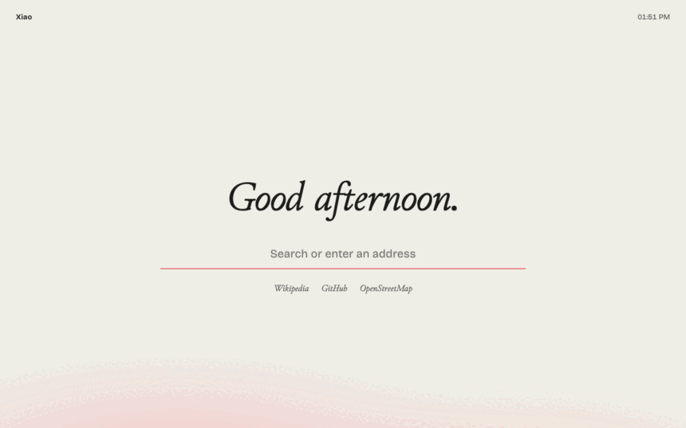

<div align="center">


# Xiao

A calm, private browser built on Zen: ad and tracker blocking built into the browser, stricter privacy settings, Tor tabs, and a search of your own.

[Website](https://gitguy268.github.io/xiao/) · [Download](https://gitguy268.github.io/xiao/download/) · [What it changes](https://gitguy268.github.io/xiao/privacy/) · [Release notes](https://gitguy268.github.io/xiao/release-notes/) · [Build from source](fork/README.md)

[](https://github.com/Gitguy268/xiao/actions/workflows/ci.yml)




</div>

## What it does

| | |
| --- | --- |
| Blocks ads and trackers | Built into the browser, not an extension. Ghostery's open-source engine with EasyList, EasyPrivacy and uBlock Origin's lists, prebuilt and refreshed daily, including hiding empty ad slots. Switch it off per site from the Xiao button. |
| Uses less memory | With six busy sites open, 2,080 MB against 2,715 MB for Xiao 0.1's extension (one run each; [how it was measured](https://gitguy268.github.io/xiao/privacy/#memory)). |
| Hardens 79 settings | No telemetry or studies, strict tracking protection, HTTPS only, DNS over HTTPS, no early connections, WebRTC without local addresses. Six more settings keep idle processes and tabs from holding memory. Strict mode adds 10, including Tor Browser's fingerprinting resistance. [Full list](https://gitguy268.github.io/xiao/privacy/). |
| Tor tabs | A "Tor" container whose tabs go through Tor, with a circuit per site (and a new one from the Xiao button) and WebRTC removed. If Tor stops, they fail; they never fall back to a direct connection. |
| Xiao Search | Optional: your own [SearXNG](https://github.com/searxng/searxng), in Xiao's style, on this computer only and running only while Xiao does. |
| Start page | Opens with every new tab (Ctrl+T included) and when Xiao starts, with search, your sites, and what was blocked. Its settings can switch back to Zen's floating address bar or to reopening your tabs. [Try it on the website](https://gitguy268.github.io/xiao/#try). |

## Install

Xiao comes as a **kit** that makes Xiao's own copy of the [Zen](https://zen-browser.app) you already have, with Xiao's code inside and a profile of its own. Your normal Zen and its profile aren't touched.

1. Download `xiao-kit.zip` from the [latest release](https://github.com/Gitguy268/xiao/releases/latest) and unzip it.
2. Run the installer:

| macOS and Linux | Windows (PowerShell) |
| --- | --- |
| `sh install.sh --tor --search` | `powershell -ExecutionPolicy Bypass -File install.ps1 -Tor` |

3. Open **Xiao** from `~/Applications`, the Start menu or your applications menu.

| Option | What it does |
| --- | --- |
| `--tor` / `-Tor` | Downloads Tor 15.0.25 (hash pinned) for Tor tabs. Tor runs only while Xiao is open. |
| `--search` | Installs Xiao Search: SearXNG at a pinned commit (hash checked) on 127.0.0.1:8890, run only while Xiao is open. Needs [uv](https://docs.astral.sh/uv/) or Python 3.10+. Not on Windows. |
| `--strict` / `-Strict` | Adds fingerprinting resistance, DNS over HTTPS only, and clears cookies on quit. |
| `--uninstall` / `-Uninstall` | Removes Xiao's copy of Zen, its profile, Tor, Xiao Search and the launcher. |

On Linux, install Zen from its tarball: Xiao copies Zen's folder, and the Flatpak can't be copied. Coming from 0.1? Run the new installer. It removes the old extension and any uBlock Origin it added, and renames `xiao.app` to `Xiao.app`. The start page's links and settings start fresh.

Full builds from Zen's source are set up in [`fork/`](fork/README.md).

## Limits

- **Not anonymity.** Tor tabs hide your IP address from sites, but Xiao doesn't look like Tor Browser, so sites can still recognise the browser. Use Tor Browser when that matters.
- **Kit Tor is a container, not a window.** Tor tabs are a container in your normal window. Zen lets you give a Space a container; choose Tor to keep Tor tabs together. Open one from the Xiao button.
- **The kit is a copy of Zen.** Xiao's code lives in its own copy, so Zen's own updater doesn't touch it. When Zen has updated, the next start of Xiao rebuilds the copy first, which takes a few seconds (on Windows, a little longer). macOS may then ask again for camera or microphone access.
- **Builds are early.** The overlay applies to Zen's source and its patches import, but no full build has been compiled yet, and builds don't include Tor.
- **Windows** is tested only by CI, and has no Xiao Search (SearXNG doesn't support it). Its Start menu shortcut has Xiao's icon, but the taskbar shows Zen's while Xiao runs.
- **Filter lists** come with the release and then from Xiao's website once a day. Until the website publishes an engine, Xiao keeps the one it was installed with.

<details>
<summary><strong>How it works</strong></summary>

- `shared/prefs/*.yaml` hold the settings in Zen's own format. The kit turns them into `user.js`, the fork copies them into Zen's `prefs/`, and the website's privacy page is generated from them.
- `core/` is Xiao's browser code, loaded by Firefox's AutoConfig (`core/loader/`) from the app folder before any window opens:
  - `Blocker.mjs` matches every request against Ghostery's engine in the parent process (`http-on-opening-request`), with a per-site allowlist. The engine is serialised at build time (`engine.bin`), so the browser never parses raw lists.
  - `actors/XiaoChild.sys.mjs` runs in each frame: cosmetic filtering, where the generic hiding sheet is parsed once per process and shared; removing WebRTC from Tor pages; and the start page's only bridge to Xiao.
  - `Tor.mjs` is a proxy channel filter: Tor-container requests go to SOCKS on 127.0.0.1:9160, with a SOCKS username and connection isolation key per site and remote DNS. Anything it can't place fails closed.
  - `StartPage.mjs` and `Toolbar.mjs` set the start page as the new tab and home page, add the one Xiao button with its panel, and put `chrome.css` (Xiao's typefaces, no empty extensions button) in every window.
- The kit's `make-app.sh` copies Zen (an APFS clone on macOS), adds the loader and `core/`, swaps in Xiao's name and icons, and removes the updater. The launcher rebuilds the copy when Zen's BuildID changes, then starts tor and Xiao Search, runs the copy on Xiao's profile, and stops them when Xiao quits.
- Xiao Search is SearXNG downloaded at a pinned commit. The installer adds one stylesheet link (`kit/search/xiao.css`) and Xiao's mark to the installed copy only.
- `fork/overlay.mjs` renames Zen, swaps the branding, merges the settings and puts the same loader and `core/` into the build. See [fork/README.md](fork/README.md).

</details>

<details>
<summary><strong>Develop and test</strong></summary>

Needs Node 22 and, for `--search`, uv or Python 3.10+.

```sh
npm ci
npm test                        # unit tests
npm run build                   # dist/core/, dist/kit/, dist/xiao-kit.zip, dist/engine/
npm run e2e                     # real Zen, throwaway home: blocking, prefs, new tab, WebRTC, Tor, fail-closed, restart
E2E_SEARCH=1 npm run e2e        # also Xiao Search
node test/e2e/memory.mjs        # memory with six busy sites open
npm run site:dev                # website at http://localhost:4321/xiao/
node test/e2e/site-shots.mjs    # the built website in Zen, desktop and phone, light and dark
```

`npm run e2e` installs the kit into a temporary home folder, starts Xiao through its launcher and drives it over Marionette. Its Tor uses port 9170, so it can run while your own Xiao is open. Set `ZEN=/path/to/zen` to pick a Zen, and `E2E_TOR=0` to skip Tor. CI runs it on macOS, Linux and Windows against Zen 1.23.3b.

</details>

## Credits and licence

Xiao is free software under the [Mozilla Public License 2.0](LICENSE), built on [Zen Browser](https://github.com/zen-browser/desktop) and Firefox. The website follows [Zen's website](https://github.com/zen-browser/www). Blocking is [Ghostery's engine](https://github.com/ghostery/adblocker); Xiao Search is [SearXNG](https://github.com/searxng/searxng). Settings draw on Mullvad Browser, Tor Browser, Waterfox, arkenfox, Betterfox and rapidfox. The typefaces are Bricolage Grotesque and Junicode. [NOTICE](NOTICE) has the details.

Xiao is not affiliated with or endorsed by Zen, Mozilla, Mullvad, the Tor Project, Ghostery, SearXNG or The Browser Company.

[Contributing](CONTRIBUTING.md) · [Design](DESIGN.md) · [Security](SECURITY.md) · [Code of Conduct](CODE_OF_CONDUCT.md) · [Changelog](CHANGELOG.md)
