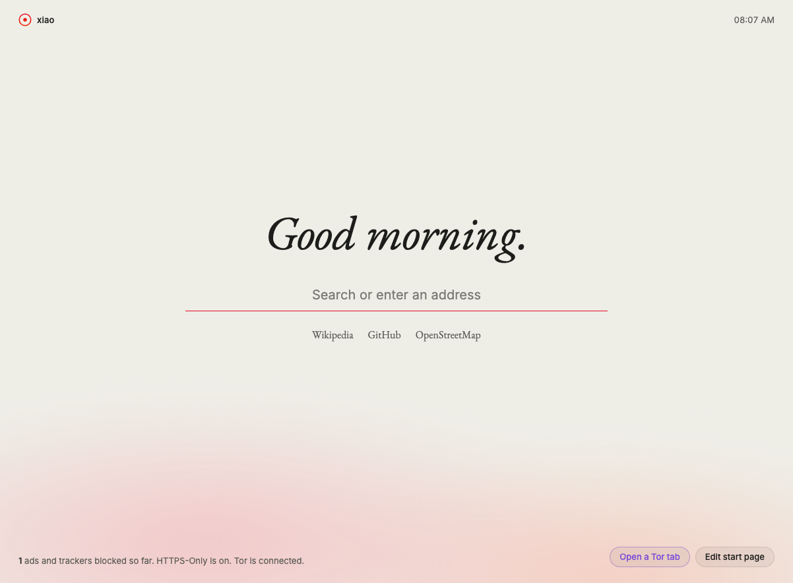

<div align="center">


# xiao

A calm, private browser built on Zen: ad and tracker blocking built in, stricter privacy settings, and Tor tabs.

[Website](https://gitguy268.github.io/xiao/) · [Download](https://gitguy268.github.io/xiao/download/) · [What it changes](https://gitguy268.github.io/xiao/privacy/) · [Build from source](fork/README.md)

[](https://github.com/Gitguy268/xiao/actions/workflows/ci.yml)




</div>

## What it does

| | |
| --- | --- |
| Blocks ads and trackers | Ghostery's open-source engine with EasyList, EasyPrivacy and uBlock Origin's lists, refreshed daily, including hiding empty ad slots. Switch it off per site from the toolbar. uBlock Origin can be added too. |
| Hardens 79 settings | No telemetry or studies, strict tracking protection, HTTPS only, DNS over HTTPS, no early connections, WebRTC without local addresses. Strict mode adds 10 more, including Tor Browser's fingerprinting resistance. [Full list](https://gitguy268.github.io/xiao/privacy/). |
| Tor tabs | A "Tor" container whose tabs go through Tor, with a circuit per site (and a new one from the toolbar) and WebRTC removed. If Tor stops, they fail; they never fall back to a direct connection. |
| Start page | Offline, with search (DuckDuckGo, Mullvad Leta, Startpage, Brave or your own SearXNG), your sites, and what was blocked. |

## Install

xiao comes as a **kit** that adds it to the [Zen](https://zen-browser.app) you already have, in a profile of its own. Your normal Zen profile isn't touched.

1. Download `xiao-kit.zip` from the [latest release](https://github.com/Gitguy268/xiao/releases/latest) and unzip it.
2. Run the installer:

| macOS and Linux | Windows (PowerShell) |
| --- | --- |
| `sh install.sh --tor` | `powershell -ExecutionPolicy Bypass -File install.ps1 -Tor` |

3. Open **xiao** from `~/Applications`, the Start menu or your applications menu.

| Option | What it does |
| --- | --- |
| `--tor` / `-Tor` | Downloads Tor 15.0.25 (hash pinned) for Tor tabs. Tor runs only while xiao is open. |
| `--strict` / `-Strict` | Adds fingerprinting resistance, DNS over HTTPS only, and clears cookies on quit. |
| `--ubo` / `-Ubo` | Also installs uBlock Origin 1.75.0 from addons.mozilla.org (hash pinned). |
| `--uninstall` / `-Uninstall` | Removes xiao's profile, Tor and launcher. |

Full builds from Zen's source are set up in [`fork/`](fork/README.md).

## Limits

- **Not anonymity.** Tor tabs hide your IP address from sites, but xiao doesn't look like Tor Browser, so sites can still recognise the browser. Use Tor Browser when that matters.
- **Kit Tor is a container, not a window.** Tor tabs are a container in your normal window. Zen lets you give a Space a container; choose Tor to keep Tor tabs together. Open one from the start page or the toolbar button.
- **The extension is the guard.** If you disable xiao's extension, Tor-container tabs connect directly.
- **Builds are early.** The overlay applies to Zen's source and its patches import, but no full build has passed CI yet, and builds don't include Tor.
- **Windows** is tested only by CI. Its Start menu shortcut has xiao's icon, but the taskbar shows Zen's while xiao runs.
- **Updates on macOS.** xiao.app is its own copy of Zen.app. When Zen.app has updated, the next start of xiao rebuilds the copy first, which takes a few seconds. macOS may then ask again for camera or microphone access.

<details>
<summary><strong>How it works</strong></summary>

- `shared/prefs/*.yaml` hold the settings in Zen's own format. The kit turns them into `user.js`, the fork copies them into Zen's `prefs/`, and the website's privacy page is generated from them.
- `extension/` is one WebExtension: `adblock.js` wires Ghostery's engine to `webRequest` with a per-site allowlist; `tor.js` answers `proxy.onRequest` for the Tor container's tabs with a SOCKS proxy on 127.0.0.1:9160, a per-site SOCKS username for circuit isolation, and `proxyDNS`; `webrtc-guard.js` removes `RTCPeerConnection` from those tabs.
- The kit's launcher starts tor (`SocksPort 9160`, its own data folder), runs `zen -profile <xiao profile>`, and stops tor when Zen quits. On macOS it lives in `xiao.app`, a copy of Zen.app (an APFS clone, so it takes almost no space) with xiao's name, icon, bundle id, menu names and About dialog, and no updater.
- `fork/overlay.mjs` renames Zen, swaps the branding, merges the settings and adds the extension as a built-in add-on. See [fork/README.md](fork/README.md).

</details>

<details>
<summary><strong>Develop and test</strong></summary>

Needs Node 22.

```sh
npm ci
npm test            # unit tests
npm run build       # dist/xiao.xpi, dist/kit/, dist/xiao-kit.zip
npm run e2e         # real Zen, throwaway profile: 22 checks incl. blocking, prefs, WebRTC, Tor, fail-closed and restart
npm run site:dev    # website at http://localhost:4321/xiao/
```

`npm run e2e` installs the kit into a temporary home folder, starts xiao through its launcher and drives it over Marionette. Set `ZEN=/path/to/zen` to pick a Zen, and `E2E_TOR=0` to skip Tor. CI runs it on macOS, Linux and Windows against Zen 1.23.3b.

</details>

## Credits and licence

xiao is free software under the [Mozilla Public License 2.0](LICENSE), built on [Zen Browser](https://github.com/zen-browser/desktop) and Firefox. The website starts from [Zen's website](https://github.com/zen-browser/www). Ad blocking is [Ghostery's engine](https://github.com/ghostery/adblocker). Settings draw on Mullvad Browser, Tor Browser, Waterfox, arkenfox and Betterfox; the look takes cues from The Browser Company. [NOTICE](NOTICE) has the details.

xiao is not affiliated with or endorsed by Zen, Mozilla, Mullvad, the Tor Project, Ghostery or The Browser Company.

[Contributing](CONTRIBUTING.md) · [Design](DESIGN.md) · [Security](SECURITY.md) · [Code of Conduct](CODE_OF_CONDUCT.md) · [Changelog](CHANGELOG.md)
